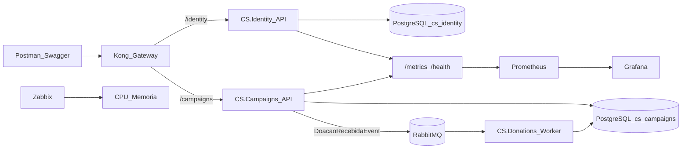
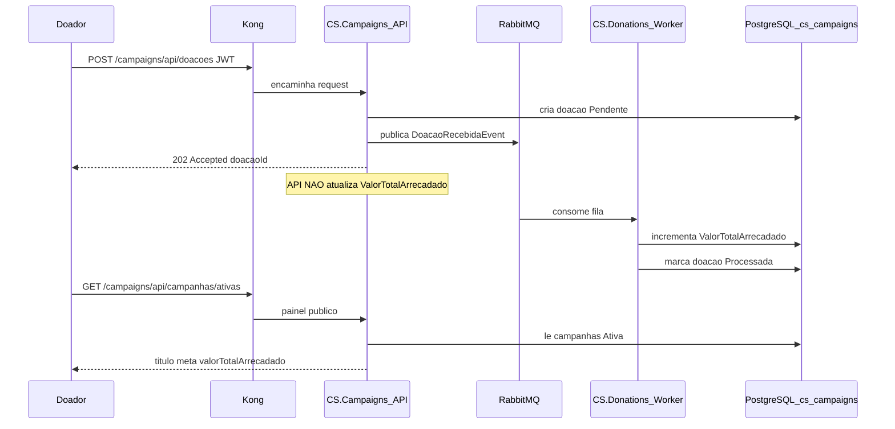

# CS.Infra — Conexão Solidária

Orquestração da plataforma (Docker Compose + Kubernetes + Kong + Prometheus/Grafana + Zabbix).

## Repositórios

- https://github.com/GabrielNatan2001/CS.Identity
- https://github.com/GabrielNatan2001/CS.Campaigns
- https://github.com/GabrielNatan2001/CS.Donations
- https://github.com/GabrielNatan2001/CS.Infra

## Diagrama de arquitetura



| Serviço | Responsabilidade |
|---|---|
| CS.Identity | Cadastro de doador, login JWT, RBAC |
| CS.Campaigns | Campanhas, painel público, intenção de doação |
| CS.Donations | Worker que atualiza `ValorTotalArrecadado` |
| CS.Infra | Compose, K8s, Kong, observabilidade |

## Fluxo de doação (assíncrono)



## Pré-requisitos

- Docker Desktop (Compose v2+)
- (Opcional) Kubernetes habilitado no Docker Desktop + `kubectl`

## Subir com Docker Compose

Clone os 4 repositórios como pastas **irmãs**:

```text
hackathon/
  CS.Identity/
  CS.Campaigns/
  CS.Donations/
  CS.Infra/   ← você está aqui
```

```bash
cd CS.Infra
docker compose up -d --build
```

### URLs

| Serviço | URL |
|---|---|
| Kong (entrada) | http://localhost:8000 |
| Identity via Kong | http://localhost:8000/identity/api/... |
| Campaigns via Kong | http://localhost:8000/campaigns/api/... |
| RabbitMQ UI | http://localhost:15672 (`admin`/`admin`) |
| Grafana | http://localhost:3000 (`admin`/`admin`) |
| Prometheus | http://localhost:9090 |
| Zabbix Web | http://localhost:8088 (`Admin`/`zabbix`) |

### Seeds

| Email | Senha | Role |
|---|---|---|
| gestor@ong.com | Teste@123 | GestorONG |
| doador@ong.com | Teste@123 | Doador |

### Fluxo de demonstração (via Kong)

```bash
# 1) Login gestor
curl -s -X POST http://localhost:8000/identity/api/auth/login \
  -H "Content-Type: application/json" \
  -d '{"email":"gestor@ong.com","senha":"Teste@123"}'

# 2) Criar campanha (use o token do gestor)
curl -s -X POST http://localhost:8000/campaigns/api/campanhas \
  -H "Authorization: Bearer <TOKEN_GESTOR>" \
  -H "Content-Type: application/json" \
  -d '{"titulo":"Natal Solidário","descricao":"Cestas","dataInicio":"2026-11-15T00:00:00Z","dataFim":"2026-12-24T23:59:59Z","metaFinanceira":50000,"status":"Ativa"}'

# 3) Login doador + doar
curl -s -X POST http://localhost:8000/identity/api/auth/login \
  -H "Content-Type: application/json" \
  -d '{"email":"doador@ong.com","senha":"Teste@123"}'

curl -s -X POST http://localhost:8000/campaigns/api/doacoes \
  -H "Authorization: Bearer <TOKEN_DOADOR>" \
  -H "Content-Type: application/json" \
  -d '{"campanhaId":"<ID>","valorDoacao":100}'

# 4) Painel público
curl -s http://localhost:8000/campaigns/api/campanhas/ativas
```

Abra o RabbitMQ Management e verifique a fila `donations.doacao-recebida-queue`.

## Kubernetes

```bash
kubectl apply -f k8s/namespace.yaml
kubectl apply -f k8s/postgres.yaml
kubectl apply -f k8s/rabbitmq.yaml
kubectl apply -f k8s/apps.yaml
kubectl apply -f k8s/kong.yaml
kubectl apply -f k8s/observability.yaml
kubectl get pods -n conexao-solidaria
```

NodePorts: Kong `30080`, Grafana `30300`, Prometheus `30090`, RabbitMQ UI `31672`.

## Documentação

- [Diagrama de arquitetura](docs/ARQUITETURA.md)
- [Justificativa dos bancos](docs/JUSTIFICATIVA_BANCOS.md) (exporte para PDF se necessário)
