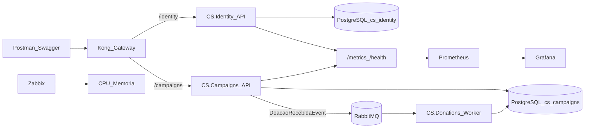

# Diagrama de Arquitetura — Conexão Solidária

## Microsserviços

| Serviço | Responsabilidade |
|---|---|
| CS.Identity | Cadastro de doador, login JWT, RBAC |
| CS.Campaigns | Campanhas, painel público, intenção de doação |
| CS.Donations | Worker que atualiza ValorTotalArrecadado |
| CS.Infra | Compose, K8s, Kong, observabilidade |
